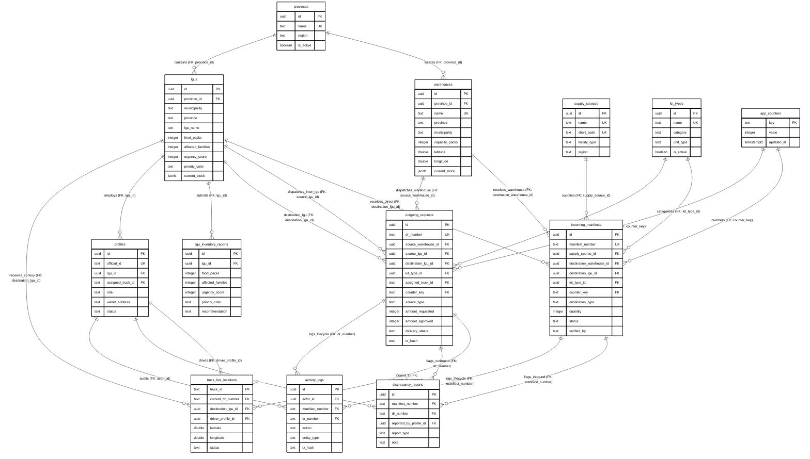

# DSWD Disaster Relief Supply Chain Management System
## Publication-Ready Database Design & Entity Relationship Architecture
### Explicit Foreign Key (FK) Mapping, Crow's Foot Notation & Full Codebase Integration

This design models all **13 PostgreSQL relational tables** with **100% of foreign key relationships explicitly defined and labeled**, reflecting the complete operational logic of the codebase:

1. **Explicit Foreign Key (FK) Integrity**:
   - Every connecting line explicitly identifies the target Foreign Key column (`FK: column_name`).
   - Every entity definition block in the Crow's Foot ERD explicitly specifies its Primary Key (`PK`), Unique Key (`UK`), and all constituent Foreign Keys (`FK`).

2. **Accurate Crow's Foot Placement**:
   - The "One" side (`||`) is placed on the parent table containing the Primary Key.
   - The "Crow's Foot" side (`o{` or `|{`) is placed on the child table containing the Foreign Key.

3. **Dual Dispatch & Mutual Aid Support**:
   - `outgoing_requests` maps `source_warehouse_id FK` to `warehouses` (`sourceType = 'Warehouse'`).
   - `outgoing_requests` maps `source_lgu_id FK` to `lgus` (`sourceType = 'LGU'` for Inter-LGU Mutual Aid).
   - `outgoing_requests` maps `destination_lgu_id FK` to `lgus` (Recipient Municipality).

4. **Dual Inbound Intake Support**:
   - `incoming_manifests` maps `destination_warehouse_id FK` to `warehouses` (`destinationType = 'Warehouse'`).
   - `incoming_manifests` maps `destination_lgu_id FK` to `lgus` (`destinationType = 'LGU'` for Direct National Drop-off).
   - `incoming_manifests` maps `supply_source_id FK` to `supply_sources` (National Resource Centers).

5. **Publication Constraints Satisfied**:
   - **Zero Emojis**: Strictly academic presentation.
   - **Pure Monochrome**: `#ffffff` fills, `#000000` text, borders, and connectors for grayscale printing.
   - **18px Text**: Configured via `'fontSize': '18px'` in theme parameters.
   - **100% Straight Lines**: Configured via `'curve': 'linear'` in flowchart options.
   - **Ultra-Compact Spacing**: Minimal node and rank spacing (`nodeSpacing: 10`, `rankSpacing: 18`) to eliminate vertical stretching.

---

### Option 1 (Recommended): Straight-Line Relational Schema with Explicit FK Labels
*Uses `flowchart TD` with 100% straight lines, 18px text, domain clusters, and explicit FK edge annotations.*

```mermaid
%%{init: {
  'theme': 'base',
  'themeVariables': {
    'primaryColor': '#ffffff',
    'primaryTextColor': '#000000',
    'primaryBorderColor': '#000000',
    'lineColor': '#000000',
    'secondaryColor': '#ffffff',
    'tertiaryColor': '#ffffff',
    'mainBkg': '#ffffff',
    'nodeBorder': '#000000',
    'clusterBkg': '#ffffff',
    'clusterBorder': '#000000',
    'fontSize': '18px',
    'fontFamily': 'Arial, Helvetica, sans-serif'
  },
  'flowchart': {
    'curve': 'linear',
    'nodeSpacing': 10,
    'rankSpacing': 18
  }
}}%%
flowchart TD

    subgraph MASTER ["1. MASTER GEO-LOGISTICS TABLES"]
        T_PROV["provinces (PK: id)"]
        T_WARE["warehouses (PK: id | FK: province_id)"]
        T_SRC["supply_sources (PK: id, short_code)"]
        T_KIT["kit_types (PK: id)"]
        T_LGU["lgus (PK: id | FK: province_id)"]
    end

    subgraph OPS ["2. SUPPLY CHAIN OPERATIONS TABLES"]
        T_IN["incoming_manifests (PK: id | FK: source_id, warehouse_id, lgu_id, kit_type_id)"]
        T_OUT["outgoing_requests (PK: id | FK: source_warehouse_id, source_lgu_id, dest_lgu_id, kit_type_id, truck_id)"]
        T_REP["lgu_inventory_reports (PK: id | FK: lgu_id)"]
    end

    subgraph TELEMETRY ["3. FLEET TELEMETRY & AUDIT TABLES"]
        T_TRUCK["truck_live_locations (PK: truck_id | FK: current_dr_no, dest_lgu_id, driver_profile_id)"]
        T_DISC["discrepancy_reports (PK: id | FK: manifest_no, dr_no, reported_by_profile_id)"]
        T_PROF["profiles (PK: id | FK: lgu_id, assigned_truck_id)"]
        T_ACT["activity_logs (PK: id | FK: actor_id, manifest_no, dr_no)"]
        T_CNT["app_counters (PK: key)"]
    end

    %% Master Geo-Logistics Links with Explicit FK Annotations
    T_PROV -->|1:N FK: province_id| T_WARE
    T_PROV -->|1:N FK: province_id| T_LGU
    T_SRC -->|1:N FK: supply_source_id| T_IN
    T_WARE -->|1:N FK: destination_warehouse_id| T_IN
    T_LGU -->|1:N FK: destination_lgu_id| T_IN

    %% Dual Dispatch Links (Warehouse-to-LGU and Inter-LGU Mutual Aid)
    T_WARE -->|1:N FK: source_warehouse_id| T_OUT
    T_LGU -->|1:N FK: source_lgu_id| T_OUT
    T_LGU -->|1:N FK: destination_lgu_id| T_OUT

    %% Kit Categorization
    T_KIT -->|1:N FK: kit_type_id| T_IN
    T_KIT -->|1:N FK: kit_type_id| T_OUT

    %% Municipal Reports & Personnel
    T_LGU -->|1:N FK: lgu_id| T_REP
    T_LGU -->|1:N FK: lgu_id| T_PROF
    T_LGU -->|1:N FK: destination_lgu_id| T_TRUCK

    %% Fleet & Delivery Links
    T_OUT -->|1:1 FK: current_dr_no| T_TRUCK
    T_PROF -->|1:1 FK: driver_profile_id| T_TRUCK

    %% Incident & Discrepancy Links
    T_IN -->|1:N FK: manifest_number| T_DISC
    T_OUT -->|1:N FK: dr_number| T_DISC
    T_PROF -->|1:N FK: reported_by_profile_id| T_DISC

    %% Security, Audit & Counter Links
    T_PROF -->|1:N FK: actor_id| T_ACT
    T_IN -->|1:N FK: manifest_number| T_ACT
    T_OUT -->|1:N FK: dr_number| T_ACT
    T_CNT -.->|FK: counter_key| T_IN
    T_CNT -.->|FK: counter_key| T_OUT

    %% Side-by-side domain alignment
    OPS ~~~ TELEMETRY

    %% Monochrome Styling Definitions
    classDef bwBox fill:#ffffff,stroke:#000000,stroke-width:1.5px,color:#000000;
    classDef bwCluster fill:#ffffff,stroke:#000000,stroke-width:2px,stroke-dasharray: 4 2,color:#000000;
    
    class T_PROV,T_WARE,T_SRC,T_KIT,T_LGU,T_IN,T_OUT,T_REP,T_TRUCK,T_DISC,T_PROF,T_ACT,T_CNT bwBox;
```

---

### Option 2: Formal Crow's Foot Entity-Relationship Diagram (ERD with All FKs)
*Standard Crow's Foot ERD connecting all 13 tables, with the crow's foot (`o{`) placed strictly on each FK entity.*

