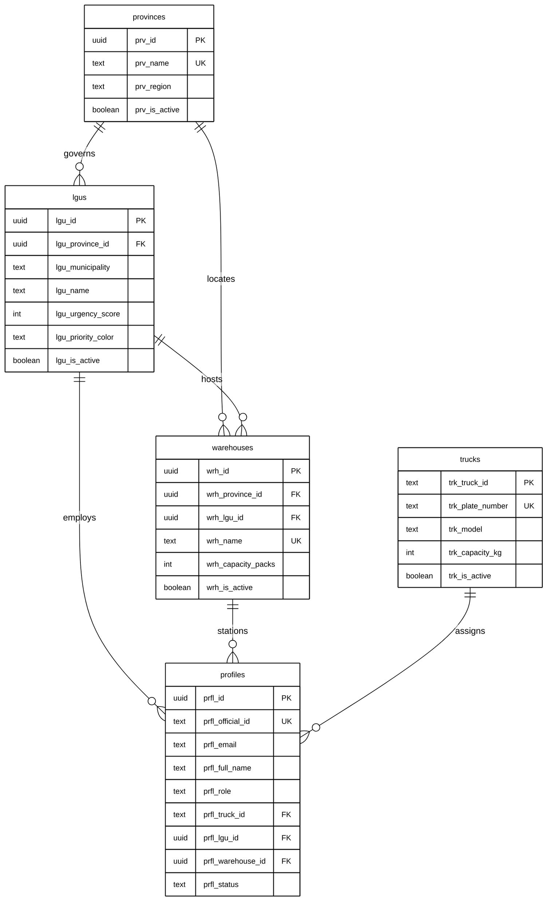
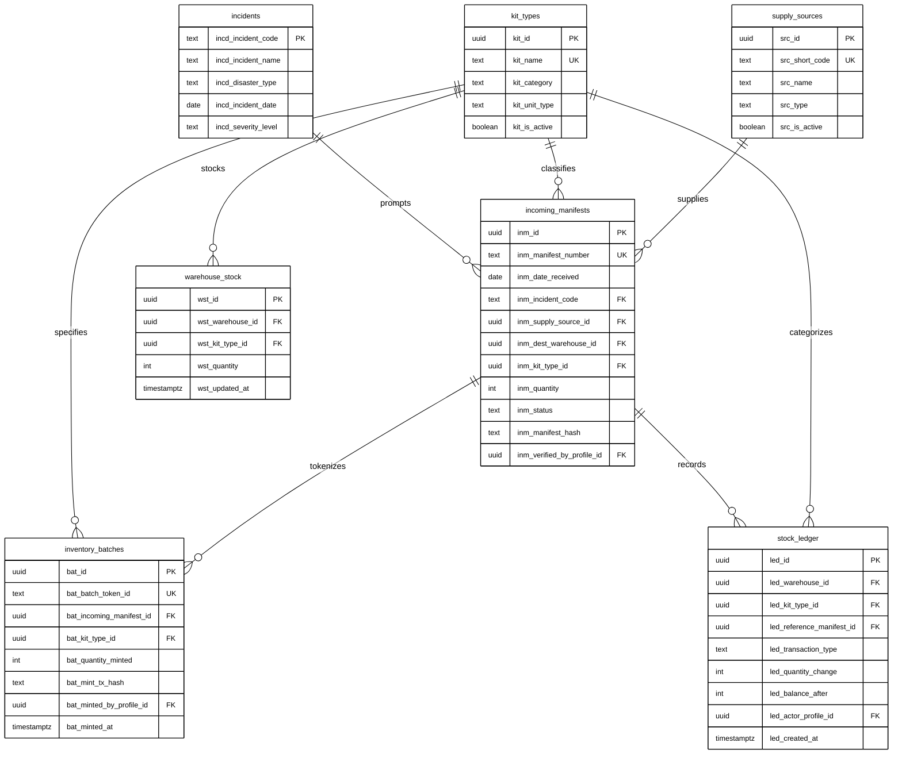
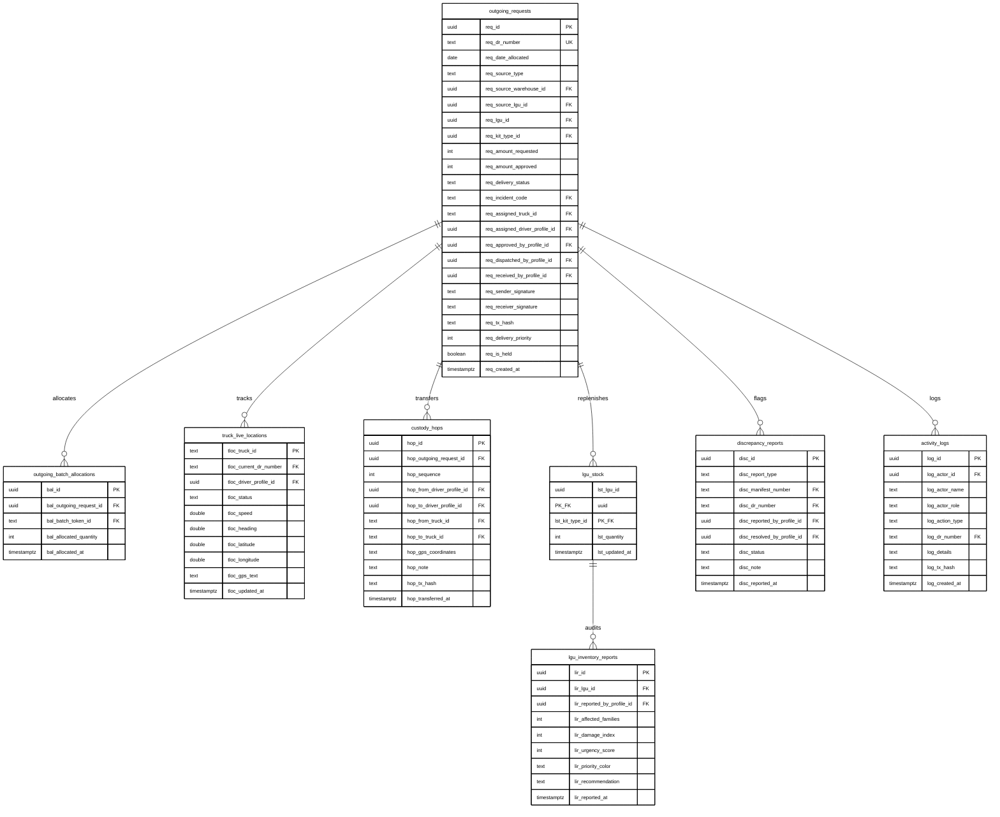

# DSWD Disaster Relief Supply Chain Management System
## Modular Publication-Ready Entity-Relationship Diagrams (ERD) - Version 3
### Academic Thesis Format | Monochrome (Black & White) | Standard Crow's Foot Notation | 8.5" x 11" Portrait Optimized

To ensure 100% legibility on letter-sized portrait paper (8.5" $\times$ 11") without visual clutter or microscopic text, the schema is decomposed into **three dedicated domain sub-models**:

1. **Figure 3.1:** *Master Geo-Logistics, Fleet & Personnel Directory* (5 entities)
2. **Figure 3.2:** *Inbound Relief Intake, Tokenized Blockchain Batches & Warehouse Inventory* (7 entities)
3. **Figure 3.3:** *Relief Dispatch, Live Telemetry, Custody Transshipment & Field Auditing* (8 entities)

---

## Figure 3.1: Master Geo-Logistics, Fleet & Personnel Directory

*Models regional jurisdictions, municipal local government units (LGUs), centralized relief warehouses, transport fleet vehicles, and authenticated user profiles.*

---

## Figure 3.2: Inbound Relief Intake, Tokenized Blockchain Batches & Warehouse Inventory

*Models incoming supplier shipments, relief goods categorization, disaster incident tagging, ERC-1155 token minting, physical warehouse stock balances, and the immutable inventory ledger.*

---

## Figure 3.3: Relief Dispatch, Live Telemetry, Custody Transshipment & Field Auditing

*Models outgoing municipal allocations, FIFO batch deprivations, live GPS convoy tracking, multi-hop transshipments, destination LGU stock, emergency needs reports, and discrepancy inspections.*

---

## Academic Thesis Integration Summary

| Figure | Subsystem Focus | Table Count | Typical Thesis Section Placement |
|---|---|---|---|
| **Figure 3.1** | Jurisdictions, Facilities & Actor Directory | 5 tables | *Section 3.2.1: System Architecture & Organizational Actors* |
| **Figure 3.2** | Inbound Procurement, Verification & Token Minting | 7 tables | *Section 3.2.2: Relief Goods Tokenization & Intake Pipeline* |
| **Figure 3.3** | Outbound Dispatch, Telemetry & Custody Tracking | 8 tables | *Section 3.2.3: Fleet Telemetry, Multi-Hop Handover & Field Acceptance* |

*Note: All tables and columns map 1-to-1 with `supabase-schema-patch-v3.sql`. Full physical definitions with exhaustive column listings are documented in Appendix: Data Dictionary.*
