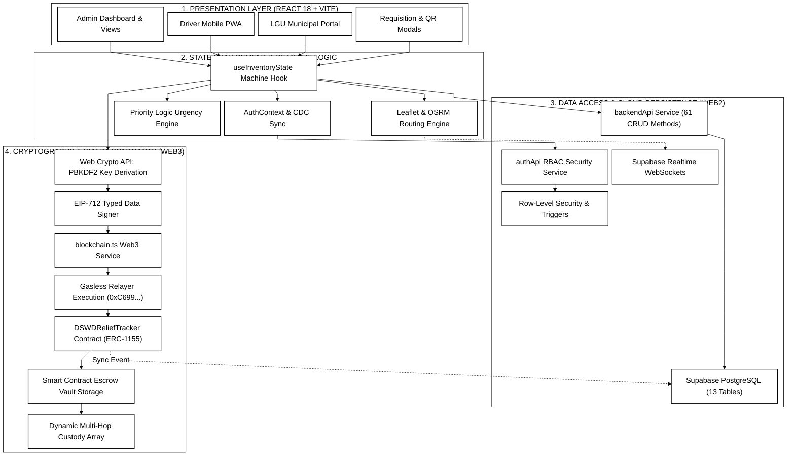

# DSWD Disaster Relief Supply Chain Management System
## Ultra-Compressed Black-and-White Software Architecture (Publication & draw.io Edition)

This Mermaid diagram models the internal **Software Architecture** of the codebase:
1. **18px Text Size**: Configured with `'fontSize': '18px'` in `themeVariables` for large, clear readability in thesis documents.
2. **Ultra-Compressed Spacing**: Configured with minimal spacing (`nodeSpacing: 10`, `rankSpacing: 18`) to pack all modules tightly without dead space.
3. **No Word Wrapping**: Single-line, crisp module titles without ` ` tags.
4. **Pure Monochrome**: `#ffffff` fills, `#000000` borders, text, and arrowheads for sharp black-and-white printing.
5. **Strictly Straight Lines**: Configured with `'curve': 'linear'` for 100% straight connections with zero wavy lines.

---

### Software Architecture Code (18px Monochrome Edition)

