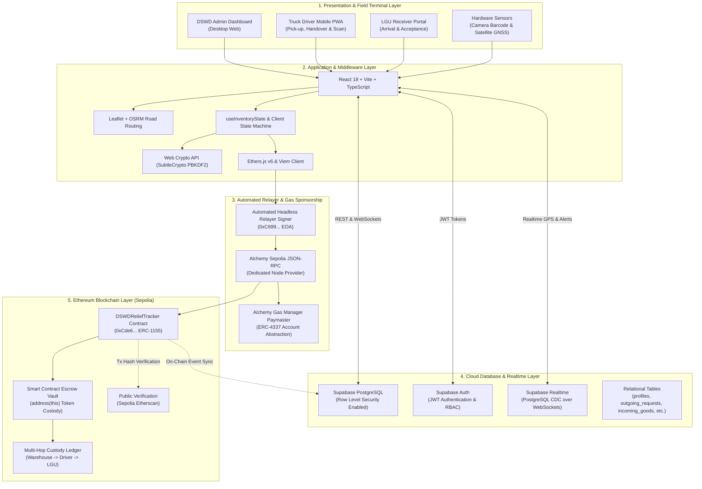
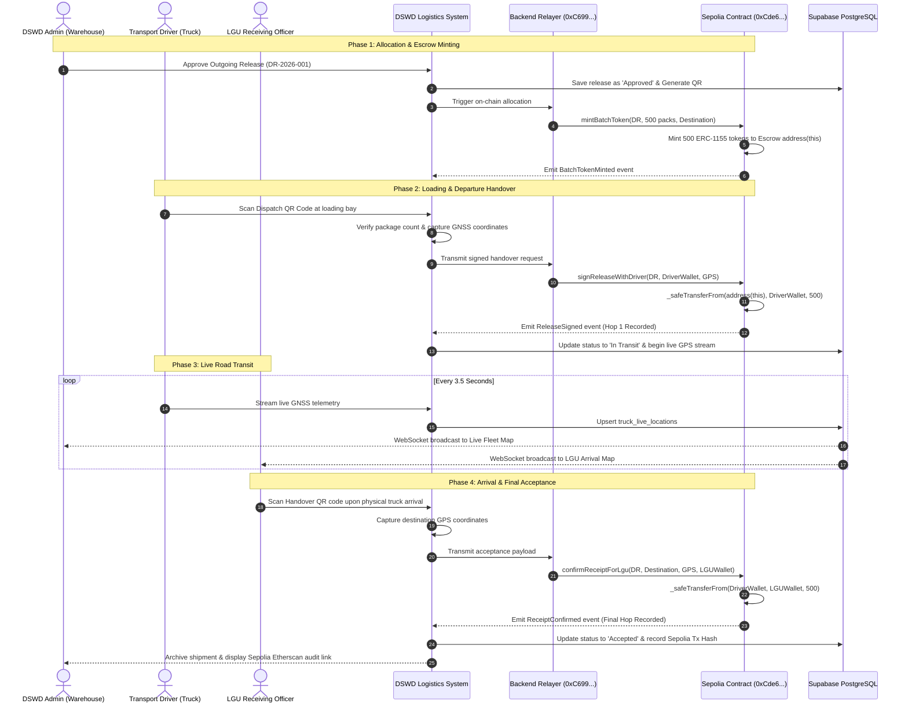
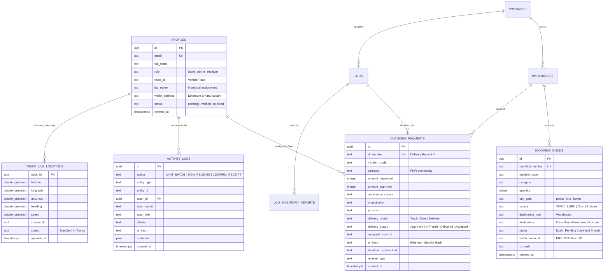

# DSWD Disaster Relief Supply Chain Management System
## Comprehensive System Architecture Specification

---

### 1. High-Level System Architecture Overview

The system implements a **Decentralized, Gasless, Real-Time Disaster Relief Logistics Platform** designed for DSWD Field Office VI. It bridges physical relief warehousing with cryptographic verification on the public Ethereum blockchain (Sepolia Testnet), without requiring field personnel to handle cryptocurrency or wallet popups.

---

### 2. Multi-Tier Layer Architecture

#### Tier 1: Presentation & Hardware Client Tier
- **Admin Dashboard**: Comprehensive logistics management interface built for regional supervisors. Enables incoming inventory recording, outgoing allocation, fleet monitoring, audit trail review, and personnel verification.
- **Driver Mobile Terminal**: Streamlined progressive web application (PWA) optimized for low-bandwidth mobile browsers. Interfaces with device hardware camera (via HTML5 `BarcodeDetector` / canvas streaming) for QR scanning and continuous GNSS geolocation sensors (`navigator.geolocation`).
- **LGU Receiver Terminal**: Dedicated municipality view allowing local emergency officers to inspect incoming relief convoys on a road-locked map, verify quantities, and sign cryptographic custody acceptance upon physical arrival.

#### Tier 2: Application & Business Logic Tier
- **React 18 & TypeScript**: Strongly-typed component architecture ensuring strict validation across inventory payloads and smart contract structures.
- **OSRM Road-Locked Engine**: Integrates Open Source Routing Machine (`router.project-osrm.org`) to snap GPS coordinates to real highways and streets, replacing straight lines with authentic driving trajectories and distance/duration estimates.
- **Deterministic Key Engine (`Web Crypto API`)**: Derives unique, secure Ethereum-compatible keypairs on the fly from user credentials using PBKDF2 with SHA-256 and salt, preventing raw private key storage on client devices.

#### Tier 3: Gasless Relayer & Node Infrastructure Tier
- **Headless Relayer (`0xC699...`)**: Acts as the transaction coordinator. Signs and broadcasts on-chain transactions in the background as soon as verified actions occur (e.g., driver QR scan, LGU confirmation).
- **Alchemy Sepolia RPC**: Enterprise-grade Ethereum node infrastructure providing high throughput, sub-second block querying, and dedicated uptime for Region VI operations.
- **Alchemy Gas Manager**: ERC-4337 Account Abstraction Paymaster policy that sponsors all network gas fees, ensuring field workers never encounter failed transactions due to zero ETH balances.

#### Tier 4: Cloud Persistence & Realtime Tier
- **Supabase PostgreSQL**: Relational database with strict foreign keys, monotonic counters, and Row Level Security (RLS) policies.
- **PostgreSQL CDC (Change Data Capture)**: Powers real-time live map updates—when a driver transmits GNSS telemetry, the coordinate stream instantly synchronizes across all active admin and LGU screens via WebSockets.

#### Tier 5: Immutable Blockchain Tier
- **Smart Contract (`DSWDReliefTracker.sol`)**: Deployed on Ethereum Sepolia Testnet at `0xCde64aBedE22F9842F5678Fe4cd84781960863eC`. Implements ERC-1155 token standards for semi-fungible commodity batches.
- **On-Chain Escrow**: Mints relief tokens directly into the smart contract vault (`address(this)`). Tokens remain safely locked until an authorized driver physically confirms departure.
- **Multi-Hop Custody Array**: Tracks the sequential physical movement of goods across intermediate logistics hops, permanently etching GPS strings, timestamps, and custodian wallet addresses into blockchain history.

---

### 3. Physical-to-Digital Custody Lifecycle Flow

---

### 4. Database Schema Entity-Relationship Diagram

