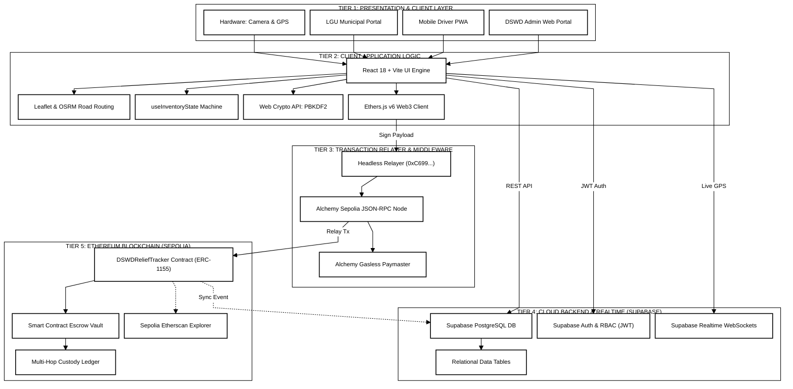

# DSWD Disaster Relief Supply Chain Management System
## Ultra-Compressed 5-Tier Black-and-White System Architecture (Single Letter Page Edition)

This Mermaid diagram maintains all **5 official architectural tiers** while compressing the entire layout to fit cleanly on a **single Letter-sized page (8.5" x 11")**:
1. **All 5 Tiers Explicitly Preserved**: Every single tier (`TIER 1` to `TIER 5`) has its own independent subgraph box.
2. **2D Grid Layout (Eliminates 3-Page Height)**: Instead of stacking all 5 tiers top-to-bottom in a vertical tower, **Tier 1 & Tier 2** sit at the top, while **Tier 4 (Cloud)** and **Tier 3 + Tier 5 (Web3 Stack)** sit side-by-side beneath them.
3. **Zero Word Wrapping**: All labels are concise, single-line names without ` ` tags or multi-line subtitles.
4. **Strictly Straight Lines**: Configured with `'curve': 'linear'` for 100% straight connections with zero squiggly lines.
5. **Pure Monochrome**: High-contrast black and white styling for crisp thesis manuscript printing.

---

### 5-Tier Ultra-Compressed Architecture Code

