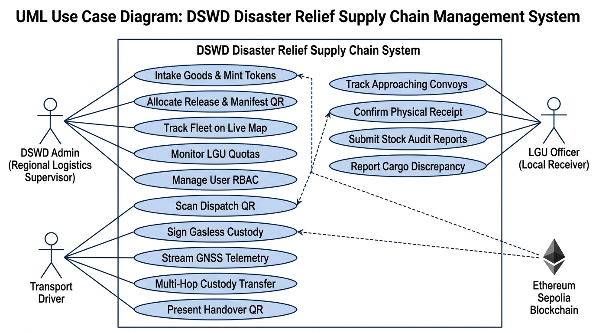
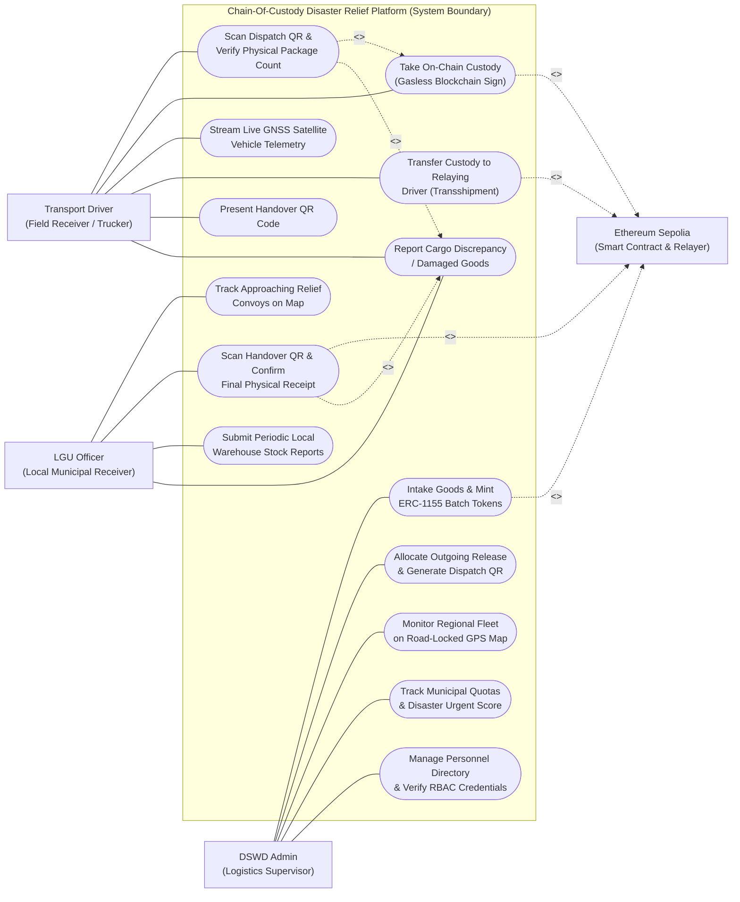

# DSWD Disaster Relief Supply Chain Management System
## Updated UML Use Case Diagram & Specification

---

### 1. Overview of Updates from Original Diagram

The original draft captured basic high-level actions (`Create Batch Token`, `View Logistics Dashboard`, `Accept Custody`, `Generate Handover QR`, `Report Damaged Goods`). Based on the actual full implementation in your codebase, this updated version incorporates:

1. **Role Alignment**: Reflects the exact system roles implemented in code:
   - **DSWD Admin** (Regional Logistics Supervisor & Warehouse Manager)
   - **Transport Driver** (Logistics Provider / Field Receiver with assigned vehicle UID)
   - **LGU Officer** (Municipal Disaster Risk Reduction & Management Local Receiver)
   - **Ethereum Sepolia Blockchain** (Secondary / Supporting System Actor executing on-chain minting, custody transfer, and gas sponsorship)
2. **True Dual-Warehouse Inventory & Batch Minting**: Separates national intake (VDRC / LDRC) and batch tokenization into the Smart Contract Escrow Vault from outgoing releases.
3. **On-Road Transshipment (Driver-to-Driver Handover)**: Incorporates vehicle breakdown/relay handling where Driver A transfers on-chain custody to Driver B.
4. **Real-Time Fleet & Road-Locked Tracking**: Captures the continuous satellite GNSS coordinate streaming and OSRM highway routing.
5. **Auditing & Personnel Management**: Accounts for credential inspection, role-based access control (RBAC), and physical stock reports.

---

### 2. UML Use Case Diagram (System Model)

---

### 3. Detailed Use Case Breakdown by Actor

#### A. DSWD Admin (Regional Logistics Supervisor)
| Use Case ID | Use Case Name | Description | Trigger / Frequency |
| :--- | :--- | :--- | :--- |
| **UC-01** | **Intake Goods & Mint Batch Tokens** | Records intake from VDRC/LDRC into Oton or Pototan warehouse and mints ERC-1155 tokens directly into the smart contract Escrow Vault. | Upon delivery of national resources |
| **UC-02** | **Allocate Outgoing Release & Generate QR** | Approves relief requests for disaster-affected LGUs, assigns transport vehicle plate, deducts warehouse stock, and outputs encrypted manifest QR. | Per disaster relief requisition |
| **UC-03** | **Monitor Fleet on Road-Locked GPS Map** | Observes active relief vehicles moving on Panay roads in real time, with drive time, distance (km), and cargo delivery sequence reordering. | Continuous during field delivery |
| **UC-04** | **Track Municipal Quotas & Urgency** | Assesses affected families vs stock rate using the automated urgency evaluation matrix (Red/Orange/Green indicator). | Ongoing disaster monitoring |
| **UC-05** | **Manage Personnel & Verify Credentials** | Inspects driver work IDs, approves pending accounts, assigns official roles (`dswd_admin` / `receiver`), and audits user activity trails. | Administrative maintenance |

---

#### B. Transport Driver (Logistics Provider / Field Receiver)
| Use Case ID | Use Case Name | Description | Trigger / Frequency |
| :--- | :--- | :--- | :--- |
| **UC-06** | **Scan Dispatch QR & Verify Package Count** | Uses smartphone camera to scan physical dispatch QR code on the warehouse manifest and confirms physical loaded package count. | At warehouse loading bay departure |
| **UC-07** | **Take On-Chain Custody (Gasless Sign)** | Automatically triggers smart contract `signReleaseWithDriver` via the backend relayer, transferring ERC-1155 tokens to driver smart account. | Automated immediately following UC-06 |
| **UC-08** | **Stream Live GNSS Satellite Telemetry** | Broadcasts vehicle latitude, longitude, speed, and accuracy to Supabase Realtime over WebSockets every 3.5 seconds. | Active while delivery status is 'In Transit' |
| **UC-09** | **Transfer Custody (Transshipment Relay)** | Transfers custody on-chain to another verified driver in case of vehicle mechanical breakdown or road transfer relay. | Exception scenario during breakdown |
| **UC-10** | **Present Handover QR Code** | Displays digital delivery proof on driver mobile screen for municipal officer verification. | Upon physical arrival at destination LGU |

---

#### C. LGU Officer (Local Municipal Receiver)
| Use Case ID | Use Case Name | Description | Trigger / Frequency |
| :--- | :--- | :--- | :--- |
| **UC-11** | **Track Approaching Relief Convoys** | Views incoming relief truck approaching municipality via road-locked OSRM driving route on the local LGU map. | Prior to truck arrival |
| **UC-12** | **Scan Handover QR & Confirm Receipt** | Scans driver's handover QR code to confirm final physical receipt; calls `confirmReceiptForLgu` on-chain and stamps destination GPS coordinates. | Upon arrival and cargo unloading |
| **UC-13** | **Submit Local Stock Audit Reports** | Records physical stock counts held at the municipal evacuation facility to update provincial disaster response tracking. | Periodic physical inventory audits |
| **UC-14** | **Report Cargo Discrepancy / Damaged Goods** | Documents damaged packaging, count mismatches, or cargo compromises into the centralized discrepancy audit log. | When physical goods deviate from manifest |

---

#### D. Supporting System Actor: Ethereum Sepolia Blockchain
- **Escrow Vault**: Holds ERC-1155 tokens until authorized warehouse dispatch.
- **Relayer Sponsor**: Programmatically signs transactions and covers 100% of network gas fees on Sepolia.
- **Immutable Ledger**: Emits indexed events (`BatchTokenMinted`, `ReleaseSigned`, `CustodyTransshipped`, `ReceiptConfirmed`) and provides independent auditability on Sepolia Etherscan.
