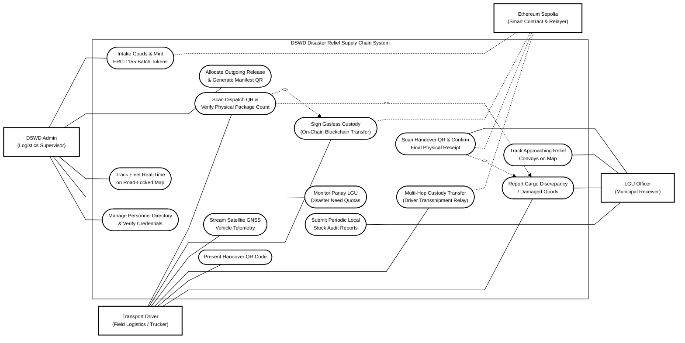
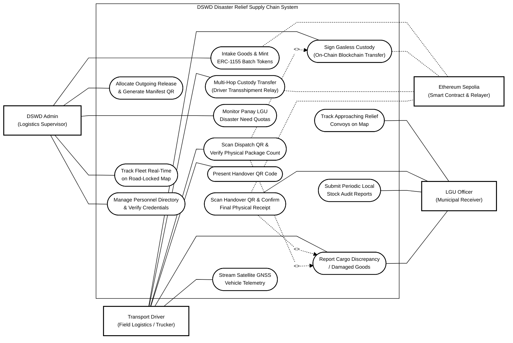

# DSWD Disaster Relief Supply Chain Management System
## Ultra-Compressed Black-and-White UML Use Case Diagram (with Ethereum Sepolia)

This Mermaid configuration is designed to fit onto a standard **Letter-sized paper (8.5" x 11")**:
1. **Zero Dead Space**: Removed nested inner subgraphs that caused the staircase offset. Every column starts level at the top line (`Row 1`), eliminating the empty space above the right half.
2. **Ethereum Sepolia Included**: Added back as a supporting on-chain actor on the right boundary, linked via dashed UML association lines (`-.-`) to `UC1` (Mint), `UC7` (Sign Custody), `UC9` (Transshipment), and `UC12` (Final Receipt).
3. **Actor Distribution**: Primary actors (`Admin`, `Driver`) on the left; receiving and supporting actors (`LGU Officer`, `Ethereum Sepolia`) on the right.
4. **Zero Curvy Lines & Grayscale**: Configured with `'curve': 'linear'` for 100% straight lines and pure `#ffffff` / `#000000` monochrome styling.

---

### Option 1 (Recommended: 3-Column Ultra-Compressed Flow)
*Height is only 5 rows tall. Perfectly balances width and height for Letter landscape or scalable portrait with zero dead zones.*

---

### Option 2: 2-Column Balanced Grid
*Height is 7 rows tall. Two columns side-by-side inside the single boundary box.*

